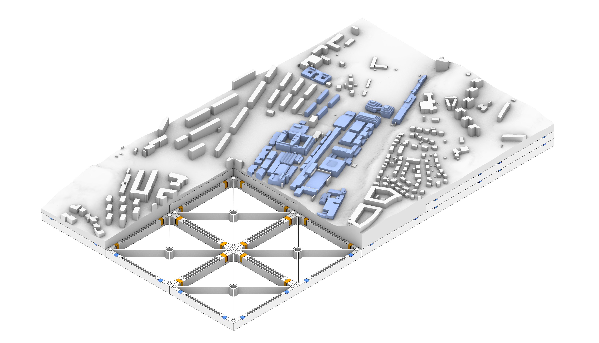
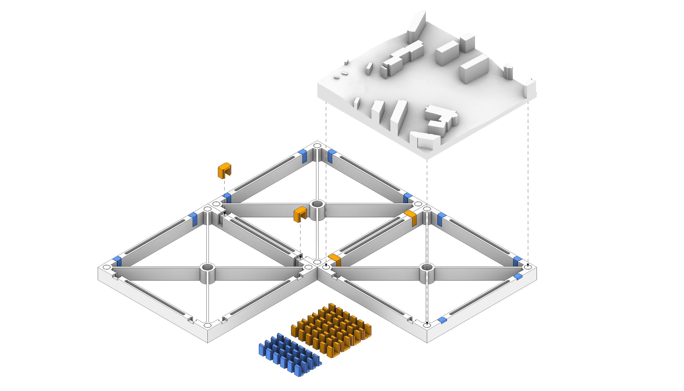
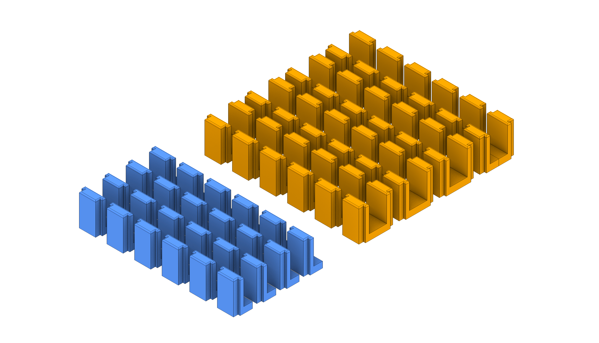
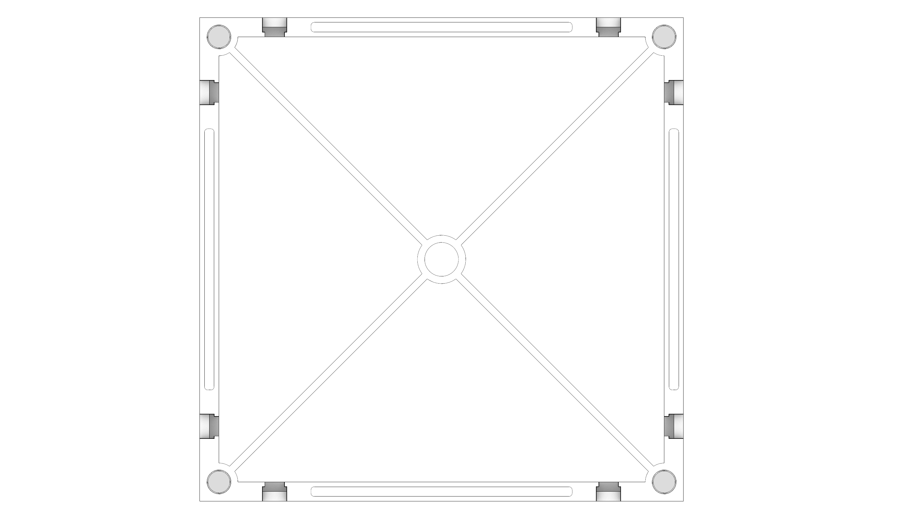

# DTCC Physical Twin

[](https://colab.research.google.com/github/SB-Chalmers/mrstudio-printing/blob/main/city_tiles/generate_tiles.ipynb)

Workflow for generating 3D printable tiles of a city model using the [DTCC platform](https://github.com/dtcc-platform/dtcc-core) and Blender.
The goal is to create a physical table surface with scaled, magnetized city tiles.



---

## Repository Structure
```
mrstudio-printing/
├─ city_tiles/            # Tile-generation notebook and its helper code
├─ base_tiles/            # Base geometry files
├─ media/                 # Images used in documentation
├─ docs/                  # Additional documentation
├─ requirements.txt       # Root Python dependencies
└─ README.md
```

---

## Workflow

This section provides an overview of the printing pipeline. For a more detailed walkthrough, see `docs/README.md`.

### 1. Generate Tile Geometry
Open the notebook `city_tiles/generate_tiles.ipynb` in Google Colab with the badge above (or [this link](https://colab.research.google.com/github/SB-Chalmers/mrstudio-printing/blob/main/city_tiles/generate_tiles.ipynb)) to prepare terrain/building tile geometry and export meshes for printing. It opens directly from GitHub, so nothing needs to be downloaded or uploaded.

The notebook cells are kept short. The code they call lives next to it in `city_tiles/`: `tile_pipeline.py` (area selection, meshing and tiling), `tile_setup.py` (package and Blender installation) and `blender_magnet_holes.py` (the Blender script for magnet holes). On Colab the setup cell clones this repository to get them.

Outputs are STL tile files saved to `processed_tiles/` (created in the notebook working directory) with names `tile_{i}_{j}.stl`, where `i` counts tiles eastward and `j` northward from the south-west corner, starting at 1. Section 7 downloads them as one zip; do this before the Colab session ends.

The options are form fields and the code cells are collapsed to forms, so the notebook can be used without editing code. Double-click a cell to see its code.

#### 1.1 Options and Setup

Run sections 1 and 2 to set parameters and install the necessary packages. Any changes to the default options can be made in section 1. Section 3 reads the options, so re-run from section 3 after changing them.

#### 1.2 Upload old meshes for boundary matching (Optional)

When generating new tiles to extend an existing model, set `ALIGN = True`. Chosen model boundaries will be expanded to automatically snap to the predefined grid. With `ALIGN = True` the mesh edge stays on the model edge (no `BUILDING_MARGIN`), so buildings crossing into the existing model are not included.

Old `raw_city_mesh.stl` files can be uploaded to the `old_meshes/` folder (automatically created when the setup cell is run). The boundaries of the new model will be matched with the meshes in this folder.

#### 1.3 Area Selection

Run cell 3 to activate the area selection tool. Draw a rectangle on the map to define the boundaries for the model. Additional shapes can be drawn on the map to select buildings that should be excluded from the tile generation. The helper prints each selected shape's width, height, and area as you draw it.

Re-run the cell to clear and start over.

When `MANUAL_BOUNDS = True` any drawn shapes will be treated as exclusion areas.

Footprints belonging to the same building are merged before exclusion, and a building is excluded only if the exclusion shape covers its whole footprint. Buildings crossing the model boundary are included whole and cut at the boundary (see 1.5).

#### 1.4 Layout preview

Run cell 4 to download building footprints from DTCC and generate a preview of the layout, including the tile grid and model dimensions. The plot is saved as `layout_preview.png` in the current notebook working directory.

#### 1.5 Mesh and Tile Generation

Cell 5 creates the city mesh, cuts it into tiles and extrudes the tiles to printable solids using functions provided by DTCC. STL files will be saved to `processed_tiles/`.

The city is meshed over an area extending `BUILDING_MARGIN` (default 50 m) beyond the model bounds, so buildings crossing the model edge are complete. Tiles are then cut on the model grid, which slices those buildings at the edge just like at any tile boundary. Increase `BUILDING_MARGIN` if long buildings at the edge come out cut short.

The tiles are extruded to individual depths, snapping to a vertical grid equal to the scaled depth of the base tiles. `Z=0m` is the default base level. This optimizes printing time and material cost, since building additional height with base tiles is more efficient. A minimum tile thickness is determined by the magnet properties.

#### 1.6 Add magnet holes (Optional)

Run cell 6 to add magnet holes to the city tiles. The existing files in `processed_tiles/` will be updated.

#### 1.7 Download results

Run cell 7 to download `city_tiles.zip` with the tiles, `layout_preview.png` and `raw_city_mesh.stl`.


### 2. Add higher LOD buildings (Optional)

The DTCC package currently generates LOD1 buildings, meaning the footprints are extruded to the maximum building height. If a higher level of detail is desired, specific buildings can be excluded in step 1.3. These buildings can then be replaced manually after the tiles are generated using Rhino3D or similar software. Buildings that cross tile boundaries need to be manually sliced along the tiling grid.

### 3. Prepare Printable Base Components
Prebuilt printable base parts are available in `base_tiles/`:

- `base_tiles/base_200x200.stl`
- `base_tiles/connectors_x24.stl`
- `base_tiles/end_caps_x24.stl`

The parametric source is also included as `base_geometry.gh`. This script can be used to adjust the dimensions and tolerances.

### 4. Slice and Print
Import the STL files into your slicer, apply printer/material settings, and print tiles plus connector parts.

---

## Parameters

* **Scale**: Default is `1:1250`
* **Tile size**: `0.20 m` (printed tile dimension)
* **Magnets**: `5 mm` radius × `2 mm` depth, with countersink and `8 mm` inset from edges
* **Base tile thickness**: `20 mm` (controls underside fill step and the effective structural depth under each tile)

You can modify these values in the notebook and base geometry definitions.

---

## Requirements

Primary workflow (recommended):

- [Google Colab](https://colab.research.google.com/)
- The setup cell in `city_tiles/generate_tiles.ipynb` installs required Python packages and Blender 4.1 on each run

The DTCC package `dtcc-core` is installed from GitHub and its functions change often, so the notebook pins it to a tested commit (`DTCC_CORE_COMMIT` in the setup cell). See "Keeping up with DTCC updates" in `docs/README.md` before changing it.

Optional local tools:

- Blender 4.1 (magnet holes; Blender 4.2 and later replaced the STL import/export operators the script uses)
- Rhino/Grasshopper (for `base_tiles/base_geometry.gh`)
- Jupyter, if running the notebook outside Colab

Optional local Python install (non-Colab), using the same pinned `dtcc-core` version as the notebook:

```bash
pip install -r requirements.txt
```

---

## Notes

* The default settings are based on the experience of printing this project using a Prusa MK4S with a 0.4mm nozzle. 100% corn-based PLA filament was used. Slicer settings and tolerances might vary depending on the printer and material used.
* Any changes regarding tile size and magnets must be coordinated with base tiles. Use the Grasshopper script `base_geometry.gh` to update the base tile geometry.
* Print a small connector + magnet test first to validate tolerances on your printer. Read more about prototyping in the `docs` folder.
* If you change tile dimensions, regenerate both tiles and connectors to keep fit and alignment.
* Be careful about magnet orientation. All magnets should have the same orientation in both city tiles and base tiles. 

## Table Design

The table system has been developed to be **lightweight, modular, and portable**, making it easy to extend, transport, assemble, and reconfigure. It is based on a grid of standardized tiles that serve as interchangeable units. Each tile can be **stacked, extended, or swapped** depending on the needs of the model.

### Key Features

- **Standardized Tiles**  
  Each tile follows the same size and geometry specification. This makes the system scalable — from a small 2×2 layout to a large multi-tile table.  

- **Interchangeable Terrain and Building Layers**  
  Students only need to prepare their **Rhino models for buildings**. These can be swapped onto existing terrain tiles without redesigning the entire base, reducing time and complexity.  

- **Lightweight Structural Base**  
  Tiles are reinforced with diagonal ribs and a central hub, ensuring stiffness while minimizing material usage and weight.  

### Connection System

To ensure easy assembly and reliable alignment, a modular base grid is assembled using connector pieces. The city tiles are then easily aligned to the grid using magnets.



- **Connector Pieces**  
  Connectors (orange) snap two neighboring tiles together securely.
  End caps (blue) are used to fill the connector gaps around the edges for a uniform look.  



- **Base Tiles**
  Base tiles are designed to provide robust alignment while using as little material as possible. The tiles have two connector slots on each side, and each corner features magnet holes on both the top and the bottom. This allows base tiles to be stacked to reduce the required depth of the city tiles.

  

- **Magnets (10 mm × 2 mm)**  
  Neodymium disc magnets are embedded into the corners and edges of tiles. These ensure tiles click into place automatically during assembly. The magnets are inexpensive and readily available online (e.g., Amazon), making the system accessible for students and labs.  

  

---
 