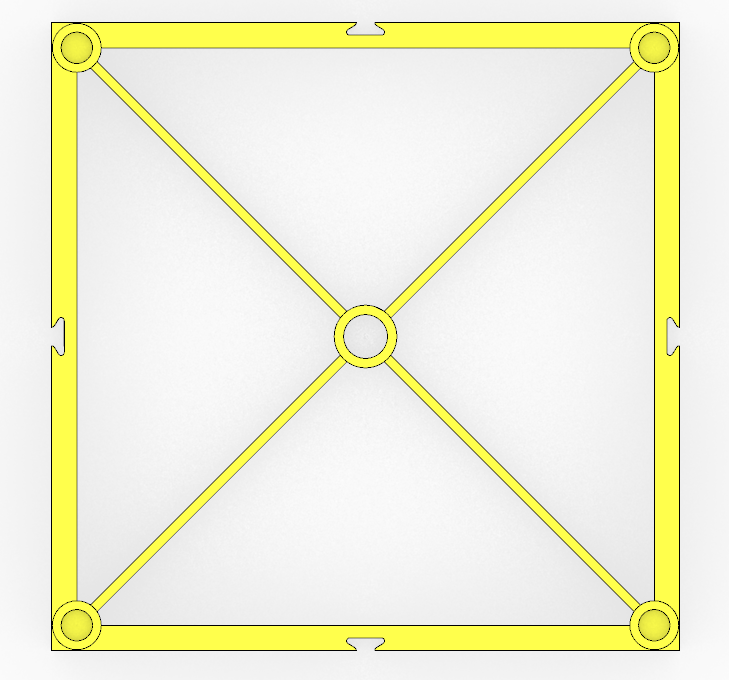
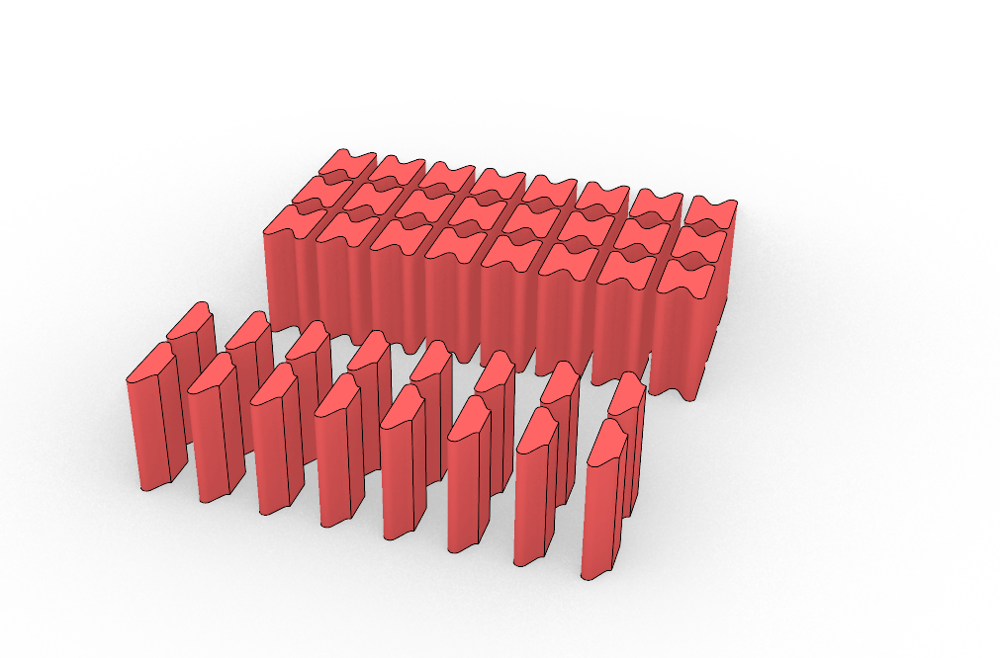
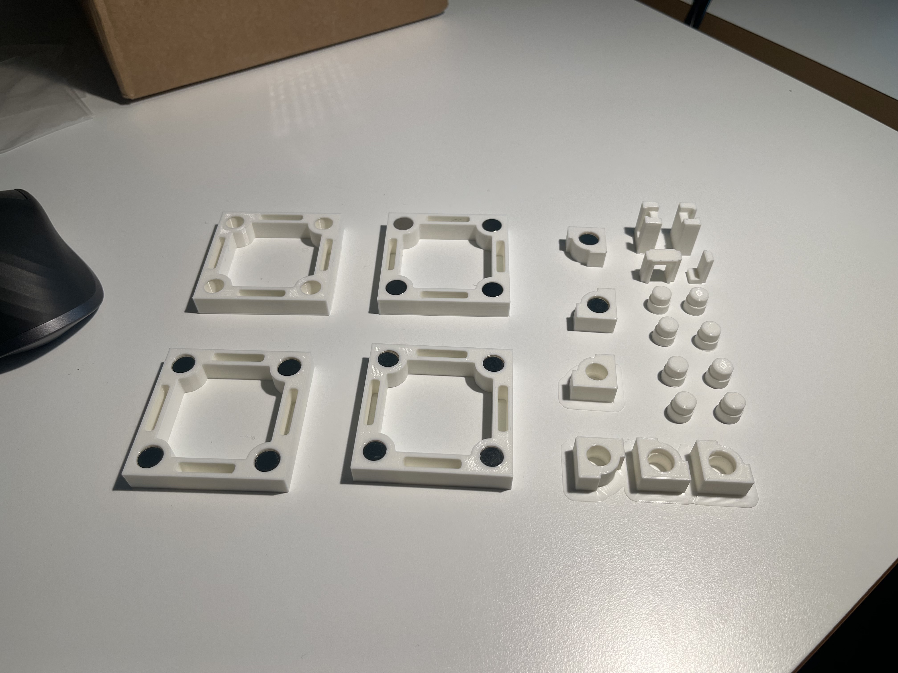
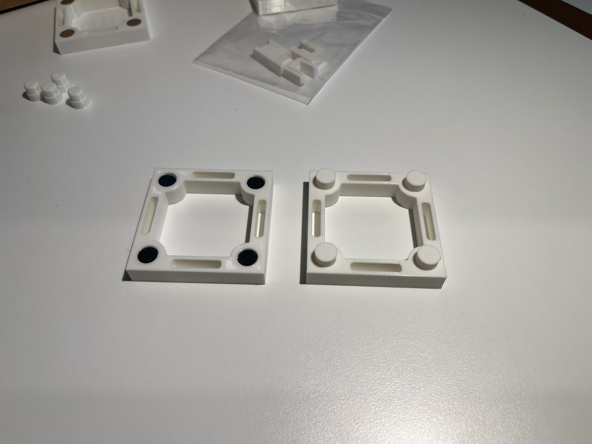
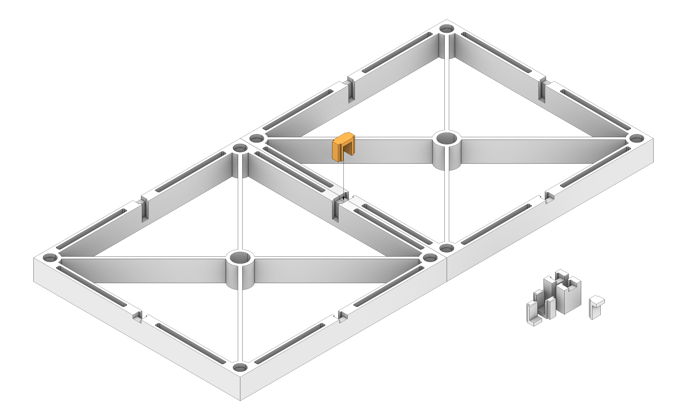
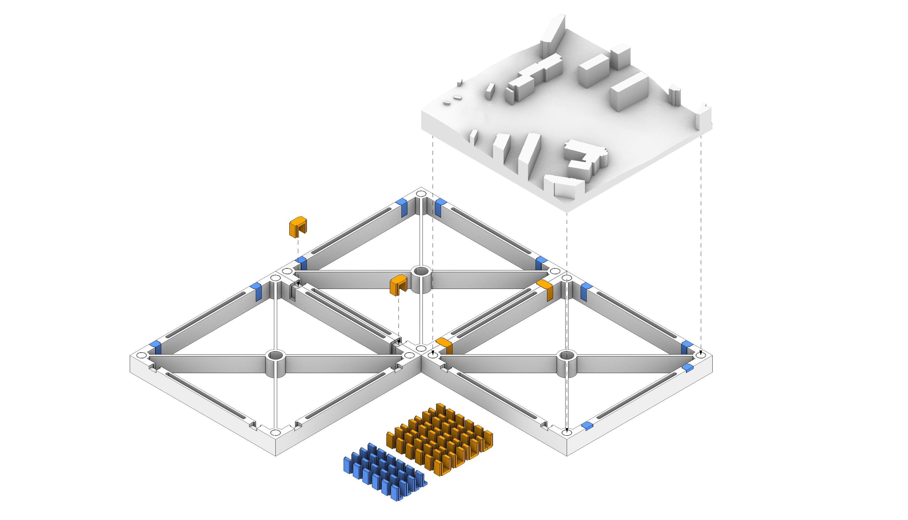

# Printing pipeline

This document describes the complete workflow for generating and printing modular city tiles, from map-based area selection and mesh generation to optional high-detail building edits, base structure preparation, and slicing.

## Table of contents

- [1. City tile generation](#1-city-tile-generation)
  - [1.1 Purpose](#11-purpose)
  - [1.2 Main Outputs](#12-main-outputs)
  - [1.3 Optional Inputs](#13-optional-inputs)
  - [1.4 Notebook Sections](#14-notebook-sections)
  - [1.5 High-Level Flow](#15-high-level-flow)
  - [1.6 Step-By-Step Pseudocode](#16-step-by-step-pseudocode)
    - [1.6.1 Options](#161-options)
    - [1.6.2 Setup dependencies and helper functions](#162-setup-dependencies-and-helper-functions)
      - [Select area](#select-area)
      - [Convert GeoJSON](#convert-geojson)
      - [Compute bounds](#compute-bounds)
      - [Download and filter buildings](#download-and-filter-buildings)
      - [Download point cloud](#download-point-cloud)
      - [Build terrain and building heights](#build-terrain-and-building-heights)
      - [Build city mesh](#build-city-mesh)
      - [Generate printable tiles](#generate-printable-tiles)
    - [1.6.3 Area Selection](#163-area-selection)
    - [1.6.4 Download Buildings and Preview Layout](#164-download-buildings-and-preview-layout)
    - [1.6.5 Generate mesh and process tiles](#165-generate-mesh-and-process-tiles)
    - [1.6.6 Generate magnet holes in Blender](#166-generate-magnet-holes-in-blender)
    - [1.6.7 Download results](#167-download-results)
  - [1.7 Add higher LOD buildings](#17-add-higher-lod-buildings)
  - [1.8 Keeping up with DTCC updates](#18-keeping-up-with-dtcc-updates)
- [2. Base structure](#2-base-structure)
  - [2.1 Modify base structure](#21-modify-base-structure)
- [3. 3D printing](#3-3d-printing)
  - [3.1 Slicer settings](#31-slicer-settings)
- [4. Prototyping](#4-prototyping)

# 1. City tile generation

This chapter mirrors the workflow in `city_tiles/generate_tiles.ipynb`. Open the notebook in Google Colab with the "Open in Colab" badge in the main README.

## 1.1 Purpose

The notebook generates printable city tiles by:

1. selecting model bounds and optional building exclusions,
2. downloading footprints and point cloud data,
3. building a terrain + buildings city mesh,
4. cutting the mesh into tiles, extruding, and scaling STL tiles for 3D-printing,
5. optionally post-processing tiles in Blender to add magnet holes.

## 1.2 Main Outputs

- `layout_preview.png`: footprint and grid preview.
- `raw_city_mesh.stl`: meshed city surface cut to the model bounds, before tiling. Can be reused in `old_meshes/` when extending the model.
- `raw_tiles/`: raw tile surfaces, `raw_tile_{i}_{j}.stl`.
- `processed_tiles/`: print-ready tiles `tile_{i}_{j}.stl`, where `i` counts tiles eastward and `j` northward from the south-west corner, starting at 1 (updated again after Blender magnet processing).

## 1.3 Optional Inputs

- `old_meshes/`: optional reference meshes used only when `ALIGN=True` to conform boundaries against previously generated meshes.

## 1.4 Notebook Sections

The notebook is organized into these sections:

1. Options
2. Setup
3. Area Selection
4. Download Buildings and Preview Layout
5. Generate mesh and process tiles
6. Generate magnet holes
7. Download results

The options in section 1 are a short code cell; the other code cells are collapsed to their titles (double-click a cell to see its code). Each section has a short instruction above it.

## 1.5 High-Level Flow

```text
set options (scale, tile size, bounds mode, alignment, magnet settings, building margin)
install/import required packages (dtcc-core pinned to a tested commit)
define processing functions

draw area on map:
  boundary polygon/rectangle
  optional exclusion polygons

convert shapes from EPSG:4326 to EPSG:3006
compute tile-aligned bounds
expand bounds by BUILDING_MARGIN (mesh area)
download building footprints in mesh area
merge footprints of the same building
keep buildings touching the model bounds
exclude selected buildings
save layout preview with tile grid

download point cloud in mesh area
build terrain raster
extract roof points
compute building heights

build city surface mesh (LOD1)
optionally conform boundary to existing STL meshes
save raw city mesh STL, cut to model bounds

cut mesh into tiles on the model grid and generate printable solids
scale tiles to print size and move to local origin
export tile STLs

write and run Blender script
add magnet holes and countersinks
export processed tile STLs
```

## 1.6 Step-by-Step Pseudocode

### 1.6.1 Options

```text
define SCALE and TILE_SIZE
define magnet and base tile settings
define optional manual bounds toggle and coordinates
define optional grid and mesh alignment to an existing model
define BUILDING_MARGIN, the extra area meshed around the model so buildings crossing its edge are complete
```

### 1.6.2 Setup dependencies and helper functions

The notebook cells only call functions. The code lives next to the notebook in `city_tiles/`:

- `tile_setup.py`: installs the Python packages and Blender
- `tile_pipeline.py`: the processing functions described below, and the `Options` that hold the settings from section 1
- `blender_magnet_holes.py`: the Blender script run in section 6

On Colab, where only the notebook is opened, the setup cell clones this repository (branch `REPO_BRANCH`, default `main`) to get these files. Run locally from `city_tiles/`, it uses the files in place.

```text
if tile_pipeline.py is not in the working directory:
  clone the repository and add its city_tiles/ folder to the Python path

tile_setup.setup(DTCC_CORE_COMMIT):
  install missing Python packages
    dtcc-core is installed from GitHub at the commit DTCC_CORE_COMMIT
  ensure Blender is available on PATH (auto-install logic for Linux/Colab)
  create output directories:
    raw_tiles/
    processed_tiles/
  create optional input directory (used only when ALIGN=True):
    old_meshes/

import tile_pipeline as tp

tile_pipeline.Options holds every setting:
  the options from section 1, read with Options.from_namespace(globals())
  terrain and meshing settings (RASTER_CELL_SIZE, MAX_MESH_SIZE, SMOOTHING, ...)
  footprint processing settings (MERGE_MAX_DIST, MERGE_MIN_AREA, MIN_HEIGHT)
  any of these can be overridden by setting a variable of the same name in section 1

tile_pipeline functions (each takes the options as opts):
  select_area()
  convert_geojson()
  compute_bounds()
  mesh_bounds()
  get_footprint()
  load_buildings()
  preview_layout()        convert_geojson + compute_bounds + load_buildings
  load_pointcloud()
  make_terrain_and_buildings()
  make_mesh()
  generate_tiles()
  generate_city_tiles()   load_pointcloud + make_terrain_and_buildings + make_mesh + generate_tiles
  add_magnet_holes()      runs blender_magnet_holes.py
  download_results()      zips processed_tiles/, layout_preview.png and raw_city_mesh.stl
```

#### Select area

```text
select_area()

  define interactive map where shapes can be drawn
  return a list that drawn GeoJSON shapes are appended to (stored as 'BOUNDARY_GEOJSON')
```

#### Convert GeoJSON

```text
convert_geojson(BOUNDARY_GEOJSON)

  convert GeoJSON features to GeoDataFrame (EPSG:4326)
  reproject to EPSG:3006

  if MANUAL_BOUNDS is false:
    first shape defines model boundary
    additional shapes define exclusion zones
  if MANUAL_BOUNDS is true:
    all shapes are treated as exclusion zones

  return boundary, exclusions
```

#### Compute bounds

```text
compute_bounds()

  compute real tile size = TILE_SIZE * SCALE

  if MANUAL_BOUNDS:
    use ORIGIN_X, ORIGIN_Y, SIZE_X, SIZE_Y
  else:
    derive origin and size from boundary extent

  if ALIGN:
    snap lower-left corner to alignment node grid

  expand max bounds so width and height are whole tile multiples
  create dtcc.Bounds from snapped extents
  report final model size and tile count
  return bounds
```

#### Download and filter buildings

```text
mesh_bounds()

  return model bounds expanded by BUILDING_MARGIN on all sides
  (no expansion when ALIGN is true, so the mesh edge can be conformed
  to the old meshes)

get_footprint()

  return a building's 2D footprint polygon
  (also found when the footprint is stored on building parts)

load_buildings()

  create boundary polygon for the model bounds
  download building footprints in mesh_bounds()
  merge footprints closer than MERGE_MAX_DIST and drop those smaller than MERGE_MIN_AREA
  keep buildings whose footprint touches the model bounds,
    including buildings crossing the boundary

  if exclusions exist:
    union exclusions into one geometry
    for each building:
      if exclusions cover the whole footprint:
        mark building as removed
      else:
        mark building as kept
  else:
    keep all buildings

  plot:
    model bounds
    exclusions
    kept buildings
    removed footprints
    tile grid overlay

  save preview image as layout_preview.png
  return kept buildings
```

#### Download point cloud

```text
load_pointcloud()

  download point cloud inside mesh_bounds()
  return point cloud
```

#### Build terrain and building heights

```text
make_terrain_and_buildings()

  build terrain raster from ground points
  extract roof points for buildings
  compute building heights relative to the terrain raster
    buildings without usable roof points get MIN_HEIGHT
  return raster and updated buildings
```

#### Build city mesh

```text
make_mesh()

  create empty dtcc.City
  add terrain and buildings
  build LOD1 surface mesh (footprints extruded to building height)
    with configured mesh parameters

  if ALIGN:
    load STL meshes from old_meshes/
    conform new mesh boundary to existing meshes

  cut mesh to model bounds and save as raw_city_mesh.stl
  return full mesh (including margin)
```

#### Generate printable tiles

```text
generate_tiles()

  real_tile_size = TILE_SIZE * SCALE
  magnet clearance is defined to accommodate for the magnet hole shaped as a cylinder with a cone on top
  magnet clearance = MAGNET_HEIGHT + MAGNET_RADIUS + 1

  for each tile position (i, j) on the model grid:
    cut tile from the mesh with the tile's bounds
      (buildings crossing the model edge are sliced here)
    skip tile if empty
    save raw tile STL to raw_tiles/
    find lowest point of tile
    compute base level using base tile thickness, anchor level, and magnet clearance
    extrude tile into printable solid
    save STL to processed_tiles/
    scale by 1 / SCALE
    translate to local print origin
    re-export tile STL
```

### 1.6.3 Area Selection

```
read the options from section 1 into opts
  (re-run from this section after changing any option)
call select_area to activate interactive map; it returns a new, empty BOUNDARY_GEOJSON
map reports each drawn shape's width, height, and area
```

### 1.6.4 Download Buildings and Preview Layout

```
call preview_layout to download buildings and plot preview of the layout, including the tile grid and model dimensions
preview image is saved as layout_preview.png
```

### 1.6.5 Generate mesh and process tiles

```
call generate_city_tiles to generate and save tiled mesh

raw mesh (cut to model bounds) is saved as raw_city_mesh.stl
raw tiles are saved to raw_tiles/
extruded tiles are saved to processed_tiles/
```

### 1.6.6 Generate magnet holes in Blender

```text
call add_magnet_holes, which runs city_tiles/blender_magnet_holes.py in headless Blender

for each STL in processed_tiles/:
  import tile
  clean mesh
  create four corner cutters where each cutter combines:
    a cylinder for the magnet pocket
    a cone above the pocket so the hole roof is printed as a gradual taper
    instead of an unsupported flat cap
  union cutters
  subtract cutters with boolean difference
  export processed STL back to processed_tiles/
```

### 1.6.7 Download results

```text
zip processed_tiles/, layout_preview.png and raw_city_mesh.stl into city_tiles.zip
on Colab, download the zip to the browser
```

## 1.7 Add higher LOD buildings
```text
notebook limitation:
  maximum generated building detail is LOD1

if higher LOD buildings are needed:
  exclude those buildings during notebook generation

Rhino workflow:
  import tile STL files from processed_tiles/
  add higher LOD building geometry
  split added geometry along tile boundaries
  cap resulting openings to create closed solids per tile

export each updated tile as STL

export settings:
  mesh quality preset = "Smooth and slower"
  keep default mesh options
  file type = "Binary"
```

## 1.8 Keeping up with DTCC updates

`dtcc-core` is installed from GitHub, not from a package index, and its functions are renamed and changed often. The notebook therefore pins it to one tested commit with `DTCC_CORE_COMMIT` in the setup cell (the same commit is in `requirements.txt`).

```text
to update dtcc-core:
  pick a newer commit hash from github.com/dtcc-platform/dtcc-core/commits/main
  set DTCC_CORE_COMMIT in the setup cell and the dtcc-core line in requirements.txt
  start a fresh Colab runtime (an existing runtime keeps the old version)
  run the whole notebook on a small test area, including an exclusion shape
  check the layout preview and the tiles at the model edge
  fix any errors against the new dtcc-core functions before committing

if the notebook breaks and there is no time to fix it:
  keep the previous DTCC_CORE_COMMIT, which is known to work
```

# 2. Base structure

The base structure is designed to create a sturdy foundation for the model that allows easy tile alignment. Base tiles are securely clipped together using connector pieces, while the city tiles attach from the top using magnets. Base tiles can also be stacked to reduce the required city tile depth in areas with large elevation differences.

The base structure consists of:
- base tiles
- connectors
- end caps

The base structure is defined by the Grasshopper script `base_tiles/base_geometry.gh`.

Typical STL files ready for printing are saved as:
- `base_tiles/base_200x200.stl`: standard 200 x 200 mm base tiles
- `base_tiles/connectors_x24.stl`: 24 connector pieces
- `base_tiles/end_caps_x24.stl`: 24 end cap pieces

## 2.1 Modify base structure
```text
open base_tiles/base_geometry.gh in Rhino/Grasshopper

adjust core parameters as needed:
  tile size
  height
  connector and end-cap offset
  magnet dimensions

bake parametric geometry to Rhino
export as STL

export settings:
  mesh quality preset = "Smooth and slower"
  keep default mesh options
  file type = "Binary"

test print base tiles and connectors to verify fit
```

# 3. 3D printing
```
printers used:
  Original Prusa MK4S HF 0.4 nozzle
  Original Prusa MK4 Input Shaper HF 0.4 nozzle

material:
  addnorth E-PLA

slicer:
  PrusaSlicer 2.9.4

typical printing times:
  city tiles: 10-15h
  base tiles: 5h

typical material usage:
  city tiles: 300-500g
  base tiles: 100g
```

## 3.1 Slicer settings

```text
preset: 0.20mm STRUCTURAL

modified settings:
  fill pattern: "Rectilinear"
  solid layers: Top: "10" (only for city tiles, to decrease translucency of projecting surface)
  brim: used when printing connector pieces
```

# 4. Prototyping

The initial idea for the base tile design was to use connectors that went all the way through the tile. Split connectors could then be used at the ends to seal the holes. Using magnets for model assembly was part of the initial concept.

**Initial Base Tile Design**




After the first test print, the connectors fit too tightly in the tiles. With the printer we used, we would have needed to reduce the connector size relative to the holes to achieve a good fit. It seemed like this solution would rely too much on friction and very precise tolerances to work well. A fit that is too tight makes the model difficult to assemble and disassemble, while a fit that is too loose could cause the connectors to fall out and create a lot of play as several tiles are connected together.

A new solution was developed: a connector that did not go all the way through the tiles, eliminating the risk of it falling out if the offset were too large. This new connector would rely on clamping force to achieve a tight connection between tiles rather than on a very snug fit in the holes.

At the same time, options for using 3D-printed plastic pins instead of magnets to assemble the model were explored.

**Base Tile Prototypes**




The images above show some early prototypes for the development of the base tiles. Magnets were clearly the best option for tile assembly. The pins, similarly to the initial connector design, relied too much on friction and a perfect fit. Loose pins allowed easy assembly, but caused too much play and rattling in the structure. A tight fit resulted in the pins being very difficult to remove after being inserted, causing difficulties disassembling the model. The ridged surface resulting from the 3D-printed layers results in very high clutch power in friction-based connections.

The new connector, however, proved to work really well. Test prints were evaluated using small connector and tile wall sections seen in the top right of the first picture. Tests like these are recommended when trying a new printer or filament, or different tile sizes.

**New Connector Design and Test Print Parts**



Since the tile walls are optimized to use as little material as possible and are thus quite flexible, having the corner magnets oriented in the same way sometimes caused the base tiles to bend away from each other. The final step in the base tile design was therefore to add a second connector to each side, giving a much more rigid connection between tiles.

**Final Design**

